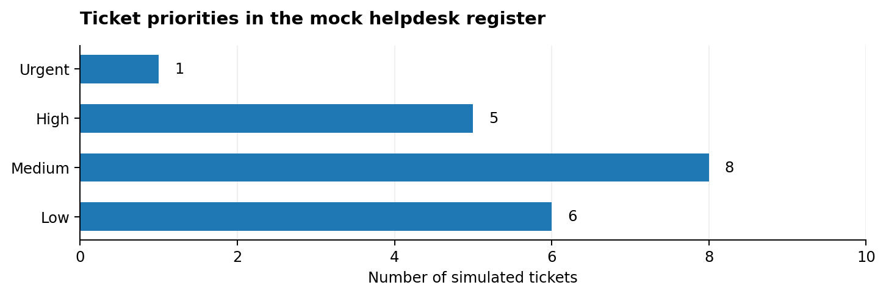

# Virtual Helpdesk Simulation | Freshdesk Ticketing & Knowledge Base

Built a **small-business IT helpdesk simulation using Freshdesk (trial version)** to practice service-desk workflows, ticket classification, issue prioritization, and troubleshooting documentation. The project includes **20 simulated support tickets** and **10 knowledge-base articles** covering common workplace IT problems.

The work focuses on organizing incoming support issues and documenting practical troubleshooting approaches. The ticket dataset is simulated, not a record of production incidents.

## Project Highlights

| Area | Work documented | Result |
|---|---|---|
| Ticket management | Prepared and classified 20 fictional IT support scenarios | 12 incidents and 8 service requests |
| Prioritization | Assigned Low, Medium, High, or Urgent priorities | 1 urgent, 5 high, 8 medium, 6 low |
| Ticket tracking | Recorded ticket IDs, subjects, types, priorities, and statuses | All 20 records marked Open in the supplied register |
| Knowledge management | Prepared troubleshooting material for recurring IT problems | 10 draft knowledge-base articles across four categories |
| Service-desk platform | Used a Freshdesk trial to explore ticket, contact, and knowledge-base views | Interface examples documented in project screenshots |

## Freshdesk Simulation

The Freshdesk environment was used to explore the layout and workflow of a helpdesk system, including ticket records, contacts, and knowledge-base content. The following screenshots were linked in the project documentation.

**Ticket dashboard**

**Ticket detail view**

**Knowledge-base view**

*The Freshdesk screenshots are externally hosted; the supplied repository archive does not contain local copies of these images.*

## Ticket Classification & Prioritization

I documented scenarios involving network connectivity, VPN access, email sign-in, password resets, software installation, hardware faults, onboarding, and a critical system outage.

| Example ticket | Type | Priority | Documented status |
|---|---|---|---|
| System Outage | Incident | Urgent | Open |
| Network Connectivity | Incident | High | Open |
| VPN Connection | Incident | High | Open |
| Password Reset | Incident | Medium | Open |
| New Employee Onboarding | Request | Low | Open |

The chart is generated from the [20-record mock ticket register](data/ticket-register.md). It summarizes **assigned priorities**, not completed work or SLA performance. The underlying records are also available as [CSV](data/mock-tickets.csv).

## Troubleshooting Knowledge Base

I developed ten draft knowledge-base entries covering **software, hardware, networking, and account-access issues**. They address problems such as application freezes, installation failures, printer jams, shared-drive access, VPN connectivity, email access, and password resets.

The [knowledge-base articles](data/knowledge-base-articles.md) organize each issue into a problem statement, diagnostic checks, and escalation criteria. They are reference material rather than claims that those procedures were executed on production systems.

## Project Outcome

- Created a structured dataset of 20 realistic support scenarios, including ticket type, priority, and status.
- Documented ten troubleshooting topics for consistent knowledge sharing and escalation.
- Practiced Freshdesk service-desk concepts and considered how a small support team could organize common requests.
- Identified the difference between a **documented ticket scenario** and a **verified resolution**: the supplied register does not record resolved outcomes or response-time measurements.

The project demonstrates practical foundations in **IT support, ticket management, incident prioritization, customer support documentation, and knowledge-base organization**.

## Technical Case Study

The [Virtual Helpdesk Case Study](Virtual-Helpdesk-Case-Study.md) provides additional detail on the simulation, ticket distribution, evidence, and limitations. A [PDF version](reports/01-virtual-helpdesk-case-study.pdf) is also available.

## Scope

This is an educational simulation using fictional support requests. The project does **not** claim live customer incidents, measured SLA attainment, API integration, or twenty successfully resolved tickets. Freshdesk API integration was researched but not implemented in the supplied project documentation.
