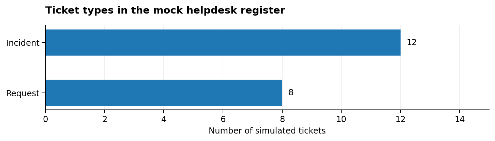
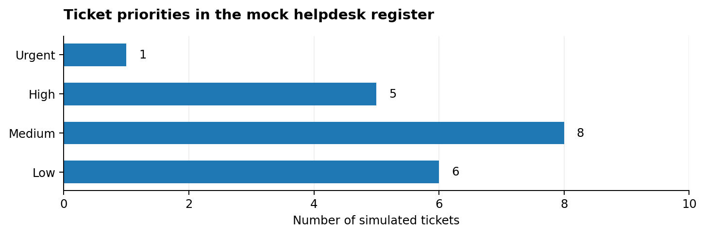

# Virtual Helpdesk Simulation — Technical Case Study

## Project Summary

Created a simulated small-business IT helpdesk using Freshdesk (trial version) and documented a 20-ticket scenario register alongside 10 draft knowledge-base articles. The project was designed to practice incident and service-request classification, prioritization, ticketing concepts, and user-support documentation.

## Environment and Artifacts

- **Platform:** Freshdesk (trial version)
- **Ticket register:** 20 fictional support scenarios with ID, subject, type, status, priority, and description
- **Knowledge base:** 10 troubleshooting articles covering software, hardware, network, and account-access issues
- **Supporting material:** Freshdesk dashboard, ticket, contacts, and knowledge-base screenshots linked from the README
- **Project constraints:** Trial-version limitations; no documented API integration or measured SLA reporting

## Ticket Classification Results

| Classification | Count |
|---|---:|
| Incidents | 12 |
| Service requests | 8 |
| Urgent priority | 1 |
| High priority | 5 |
| Medium priority | 8 |
| Low priority | 6 |
| Open status | 20 |

The ticket subjects include a system outage, VPN connection failures, shared-drive access problems, password reset requests, device faults, and employee onboarding. Priorities were assigned in the simulated register; they were not validated against a production SLA policy.

## Helpdesk Workflow Demonstrated

1. **Record the issue:** Identify the user's reported problem and its scope in a ticket record.
2. **Classify the request:** Distinguish incidents (for example, network connectivity) from service requests (for example, onboarding).
3. **Assign priority:** Use an Urgent / High / Medium / Low field in the simulation.
4. **Reference troubleshooting documentation:** Maintain draft knowledge-base articles for recurring problems.
5. **Escalate appropriately:** The revised knowledge-base articles describe conditions that would require further support or authorization.

This is a description of the simulated workflow and documentation design, not proof that all five steps were performed for every ticket.

## Knowledge-Base Work

Ten draft articles were prepared across four categories:

- **Software:** unresponsive applications; installation failures.
- **Hardware:** freezing computers; printer paper jams.
- **Network:** no internet, shared-drive access, slow connections, VPN failures.
- **Accounts & access:** email access; password resets.

The reviewed article set uses consistent problem, checks, and escalation sections. Guidance was tightened to avoid unsafe shortcuts such as disabling security software or bypassing access controls.

## Evidence and Limitations

**Supported by the supplied repository:** the 20-row ticket register, its assigned classifications and statuses, ten knowledge-base topics, a project learnings document, and externally hosted Freshdesk interface screenshots.

**Not established by those artifacts:** completed resolutions for the 20 tickets, response or resolution times, SLA attainment, implemented Freshdesk API integrations, and live business deployment. All 20 source ticket records are Open. The linked interface screenshots were not included as image files in the uploaded archive.

## Outcome

Produced a reusable mock ticket register and a structured troubleshooting knowledge base, with documented practice using Freshdesk ticketing concepts. The project demonstrates helpdesk workflow design, issue prioritization, knowledge management, and attention to accurate incident reporting.

## Project Artifact

- [Ticket register](data/ticket-register.md) and [CSV dataset](data/mock-tickets.csv)

